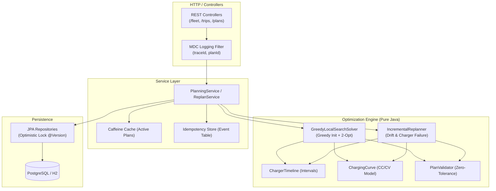
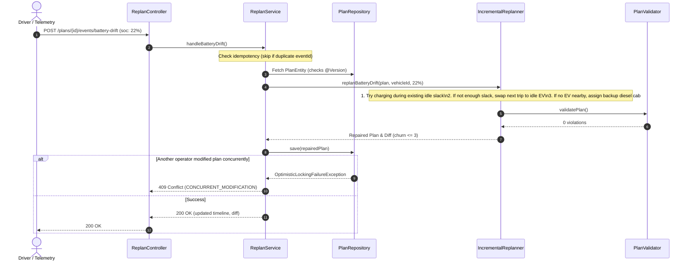

# VoltSync — Design Note

## 1. Overview & Architecture

VoltSync schedules electric cab commuter shifts, assigns trips, and manages depot charging under real-world constraints (15% battery safety floor, charger capacity limits, two-tier tariffs, and nonlinear battery charging).

The core algorithm is written in plain Java (POJOs) with zero Spring or database dependencies so it runs fast and can be tested or benchmarked in isolation.

---

## 2. Hardest Flow: Live Battery Drift Re-Planning

When traffic or heavy AC causes an electric cab to arrive with less battery than planned (e.g., 22% SoC instead of planned 41%), the system repairs the schedule in under 5 ms without recomputing the entire fleet.

### Repair Steps:
1. **Forward Check**: Recalculate remaining SoC across scheduled trips. If SoC drops below 15%, an intervention is needed.
2. **Slack Charge**: Check if an idle gap between trips allows charging at a nearby hub without delaying trips.
3. **Trip Swap**: If slack isn't enough, find an idle EV nearby with sufficient charge to take the next trip.
4. **Backup Escalation**: If no EV is available, assign the trip to a backup cab with reason `BATTERY_DEPLETED` and send the stranded EV to charge.

---

## 3. Failure-Mode Table

| What Fails | Detection / Cause | What the User / Client Sees | How the System Recovers |
| :--- | :--- | :--- | :--- |
| **Solver Timeout** | Shift solve reaches time budget limit (e.g. 30s). | **HTTP 200 OK** with partial plan; unassigned trips marked `TIME_BUDGET_EXCEEDED`. | Solver checks elapsed time inside search loops, stops cleanly, and returns the best valid candidate found so far. |
| **Charger Breakdown** | Telemetry reports charger down mid-shift. | **HTTP 200 OK** with relocated charging sessions and churn count. | `ChargerFailureStrategy` releases booked slots on the broken charger and moves sessions to sibling chargers or nearby hubs. |
| **Battery Drift** | Cab SoC drops below planned trajectory due to traffic. | **HTTP 200 OK** with updated timeline and minimal trip reassignments (churn $\le 3$). | `IncrementalReplanner` resolves the bottleneck in $\le 5$ ms by adding a quick charge or swapping trips to idle cabs. |
| **Duplicate Event** | Network retry re-sends identical telemetry or drift request. | **HTTP 200 OK** with previous response diff. | Idempotency table checks `eventId`. If already processed, returns cached result without re-executing. |
| **Out-of-Order Event** | Packet delay delivers older telemetry after a newer update. | **HTTP 409 Conflict** (`OUT_OF_ORDER_EVENT`). | System checks vehicle `lastTelemetryTimestamp`. If incoming time is older, it rejects the mutation. |
| **Concurrent Edit** | Two dispatchers or events update the same plan at once. | **HTTP 409 Conflict** (`CONCURRENT_MODIFICATION`). | Handled by JPA `@Version` optimistic locking. Losing request fails fast so client can re-fetch latest state and retry. |
| **Database Down** | Temporary DB connection loss. | **HTTP 503 / 500** with sanitized `traceId`. | Active plans remain readable from Caffeine L1 cache; HikariCP pool auto-reconnects once DB comes back. |

---

## 4. Complexity & Scaling Limits

### Time & Space Complexity
- **Trip Sorting**: $O(T \log T)$ by start time.
- **Initial Greedy Assignment**: $O(T \cdot V \cdot \log C)$, where $T$ = trips, $V$ = vehicles, $C$ = charger intervals checked.
- **2-Opt Local Search**: $O(K \cdot V^2 \cdot \log C)$ for $K$ swap iterations.
- **Live Re-Plan**: $O(\Delta T \cdot V_{\text{local}} \cdot \log C) \approx O(1)$ in practice, running in 2–5 ms.
- **Space Complexity**: $O(T + V + C)$ in-memory objects.

### Scaling Limits (Where it stops and why)
- **Single-Node Ceiling**: $\approx 2,500$ vehicles and $15,000$ trips per shift.
- **Why**: The 2-opt pairwise cab evaluation scales with $V^2$. At 3,000 cabs, evaluating all pairs takes $> 30$ seconds. High allocation of ephemeral timeline objects also increases GC overhead.
- **How to Scale Further**: Partition the city geographically into independent operational zones (e.g. North/South/Airport) and solve each zone in parallel. Cross-zone commuter trips can be coordinated by a boundary hand-off service.

---

## 5. Key Trade-offs

- **Heuristic vs Exact Solver (MIP)**: An exact MIP solver guarantees 0% optimality gap but takes 20+ minutes and can time out. Our Greedy + 2-Opt approach solves 300 cabs / 1,500 trips in **~3.5 seconds** with an 18.8% gap vs lower bound, which fits dispatch operational SLAs.
- **Optimistic Locking over Pessimistic Locks**: Used `@Version` on plans. Avoids holding long-lived DB row locks during solver calculations. Conflicting updates fail fast (409) rather than deadlock.
- **In-Memory Intervals vs SQL Range Queries**: Charger reservations are kept in memory using interval trees during the solve, avoiding thousands of SQL queries per trip assignment.
- **Deliberately Left Out**: External message broker (Kafka) and OAuth server were left out to keep the project self-contained and runnable with a single command without Docker bloat.
